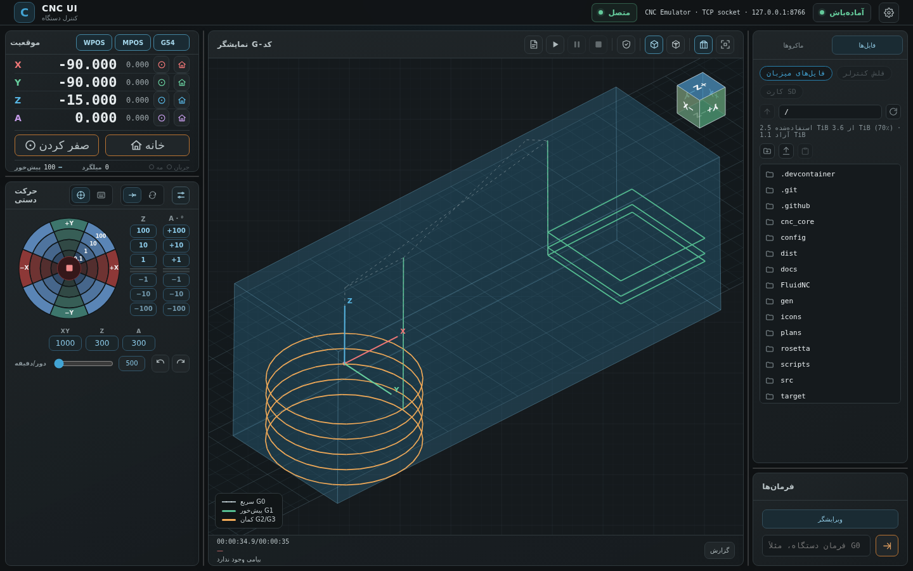
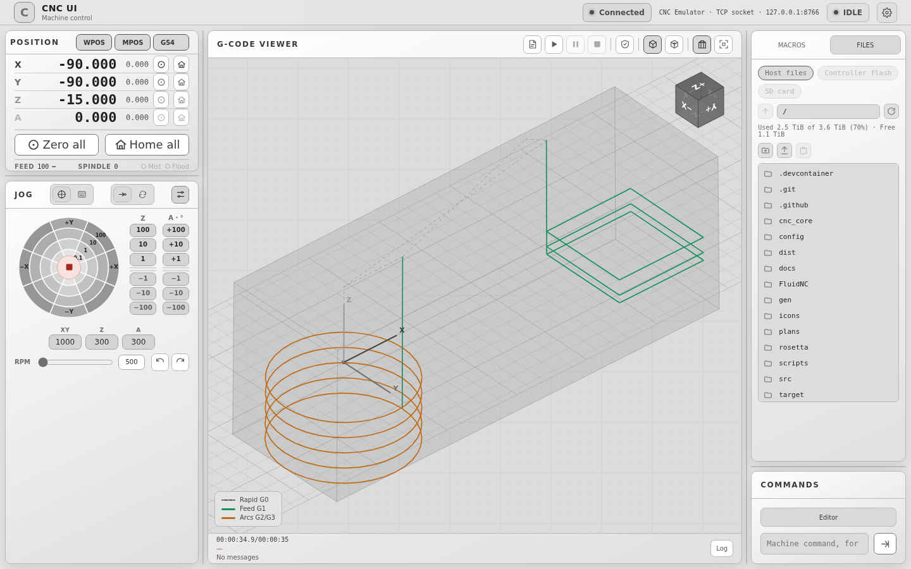
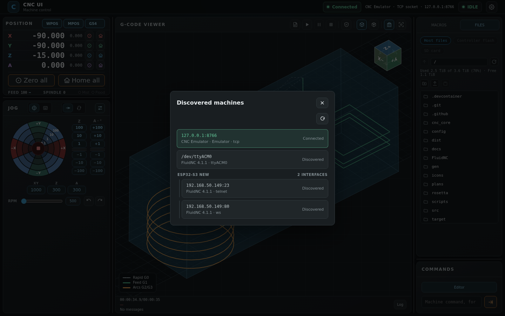
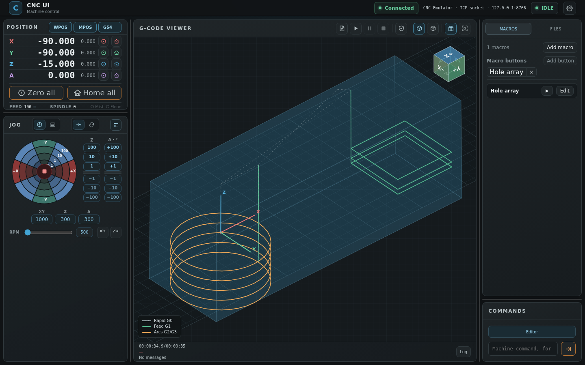
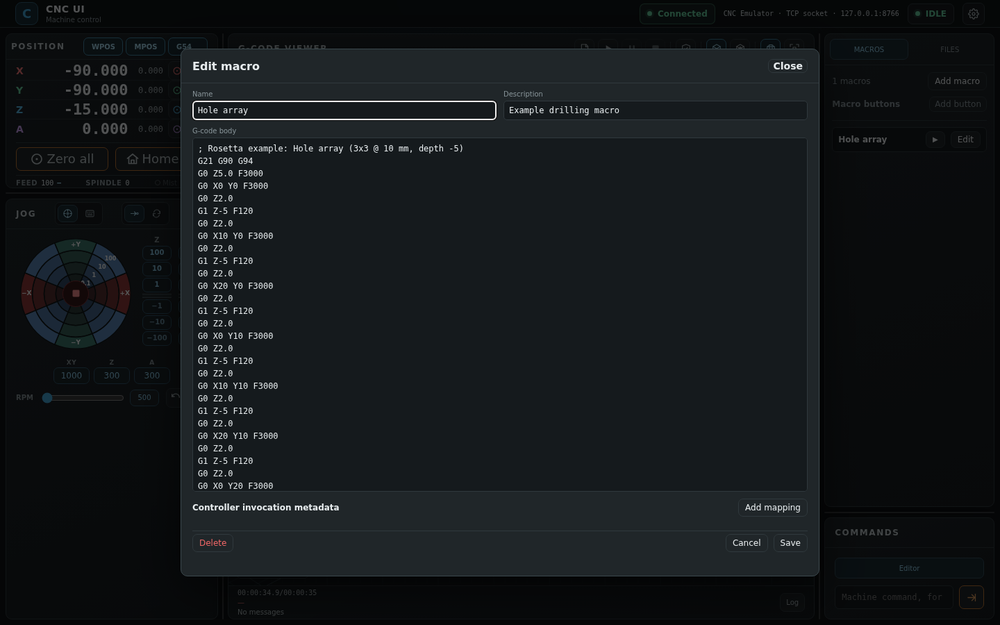
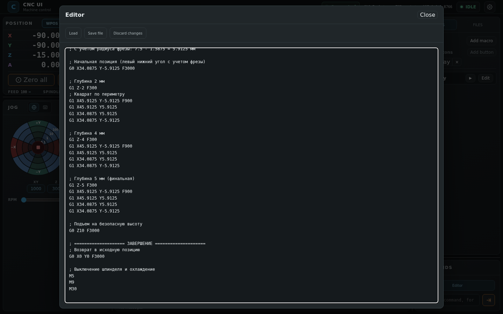
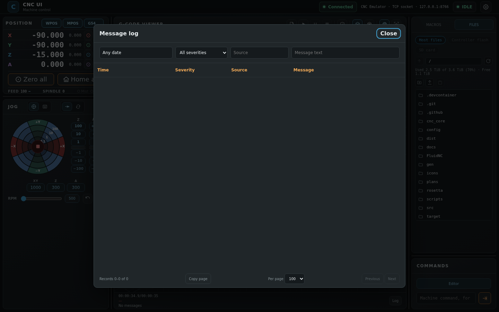

# CNC UI

A CNC control application built with Rust and Tauri. It provides a desktop interface and an optional browser-based web interface, plus a standalone software emulator for development and testing without a physical machine.

The UI communicates with the selected backend through a project-specific CNC API (`cnc_core`). The emulator uses a loopback TCP endpoint and a JSON protocol inspired by LinuxCNC; it is **not NML-compatible** and is not a replacement for a LinuxCNC controller.

## Screenshots

The interface supports English, Russian, Chinese, and Persian (RTL), plus dark,
light, green, and grayscale themes. Choose them in Interface settings; selections
persist in the browser or desktop webview. The screenshot script captures Persian
RTL and grayscale variants alongside the other examples.

Characteristic screenshots live under [`docs/images/`](docs/images). Run
[`scripts/take-screenshots.sh`](scripts/take-screenshots.sh), or run the Python
Playwright capture directly against a running web UI with at least one saved macro:

```bash
PYTHONPATH=/usr/local/lib/python3.11/dist-packages python3 scripts/take_screenshots.py http://127.0.0.1:8080
```

The script captures standard dialogs, a configured macro shortcut, Persian RTL,
and grayscale dashboards.


*Persian RTL dashboard (generated by the screenshot script):*


*Grayscale theme (generated by the screenshot script):*


*Machines dialog — grouped interfaces of the same controller:*


*Configurable macro quick-run buttons:*


*Macro editor — a seeded Rosetta example macro:*


*Program editor:*


*Message log with filters:*


## Features

- Tauri desktop application and optional browser-based web interface (the same UI)
- Machine discovery and live switching: FluidNC controllers on the LAN (WebSocket/Telnet probes) or on serial COM ports, and GRBL 1.1 boards on serial COM ports, all listed in one machines dialog (the interfaces of one physical machine are grouped under a shared header)
- XY/Z/rotary jog controls with dial and key-pad modes, incremental and continuous movement, per-axis configurable speeds
- G-code program upload, toolpath visualization in a 3D scene (stock, projection toggle, fit), and run/pause/resume/abort controls with line tracking
- File manager: browse the host filesystem and the FluidNC flash/SD storage over the controller's HTTP/WebDAV server, open G-code/stock/text files, upload, download, rename, move, copy, delete
- User macros: add/edit/delete named macro definitions with per-controller invocation metadata (e.g. an `M6xx` mapping for LinuxCNC-style backends or a custom command for FluidNC); stored persistently in SQLite
- Position readouts, work-coordinate selection (`G54`–`G59.3`), zeroing and homing controls
- Spindle speed and direction controls with telemetry display
- Machine console with command history and a persistent message log (severity/source/date filters, pagination)
- Localized interface (English, Russian, Chinese, Persian) and multiple color themes
- Optional HTTP Basic authorization for the web server (`CNC_UI_AUTH[_USER/_PASSWORD]`;
  disabled by default and switchable off with `CNC_UI_AUTH=off`)
- Standalone emulator with simulated motion, spindle, coolant, homing, and soft limits
- YAML configuration for emulator axis limits and dynamics

## Requirements

- Linux, Windows, or macOS
- Rust toolchain and Cargo
- Tauri platform prerequisites (WebKitGTK on Linux, Microsoft Edge WebView2 on Windows, and WebKit on macOS)

Install the prerequisites for your distribution using the [Tauri prerequisites guide](https://v2.tauri.app/start/prerequisites/).

## Build

Build the unified executable for the current operating system from the repository root:

```bash
cargo check --no-default-features --bin cnc_ui
cargo build --release --no-default-features --bin cnc_ui
```

Those commands provide `--web` and `--emu` without the native Tauri GUI libraries. For a binary that also supports `--desktop`, build with the default `desktop` feature and install that platform's Tauri prerequisites:

```bash
cargo check --bin cnc_ui
cargo build --release --bin cnc_ui
```

The default build includes the desktop shell. A browser-only build can omit Tauri with `--no-default-features`; `--web` remains available while `--desktop` reports that desktop support was not compiled in. Each executable targets one operating system: build on Linux for Linux, or on Windows for Windows. Linux desktop builds and the unified Linux release archive require Tauri's Linux build prerequisites (including `libwebkit2gtk-4.1-dev`, GTK development libraries and related packages); desktop execution also needs compatible WebKitGTK runtime libraries installed on the host. Windows desktop builds require the Microsoft WebView2 runtime.

## Run

The unified executable supports one frontend mode and optional emulator startup:

```bash
./target/release/cnc_ui --desktop
./target/release/cnc_ui --web
./target/release/cnc_ui --web --emu
./target/release/cnc_ui --desktop --emu
```

`--desktop` starts the Tauri window; `--web` starts the HTTP server. `--emu` starts the emulator as a supervised background worker in the same process; it is stopped and joined when the frontend exits. For Windows, run `cnc_ui.exe` with the same flags in PowerShell or Command Prompt. If neither frontend flag is supplied, desktop mode is selected. The emulator reads `config/emulator.yaml` and listens on `127.0.0.1:8765` by default; override the endpoint with `CNC_EMULATOR_ADDRESS` and the config path with `CNC_EMULATOR_CONFIG`. Flags are single-use: duplicate options and selecting both frontend modes are errors; `--help` prints usage and exits without starting services.

The standalone `cnc-web` binary is still available for browser-only packaging, but the unified mode selector is `cnc_ui`.

Logs are written to stderr through `tracing`; `RUST_LOG` controls the verbosity (default `info`).

The web server listens on `0.0.0.0:8080`; override it with `CNC_WEB_ADDRESS` (for example `CNC_WEB_ADDRESS=127.0.0.1:8021`) and open the matching address in a browser.

Authorization is disabled by default. Set credentials to protect the server with HTTP Basic auth over every route (API and UI):

```bash
CNC_UI_AUTH_USER=operator CNC_UI_AUTH_PASSWORD='secret' cargo run --bin cnc-web
```

`CNC_UI_AUTH=on` forces auth even without a configured password (a random one is printed to the log); `CNC_UI_AUTH=off` disables it explicitly. Without credentials the server stays open — use it only on a trusted network.

To use a different emulator endpoint with the unified launcher, configure the address once; it is used by both the in-process emulator worker and the web backend:

```bash
CNC_EMULATOR_ADDRESS=127.0.0.1:8766 ./target/release/cnc_ui --web --emu
```

## Persistent storage

The message log, command history, cached discovery endpoints and user macros live in a single SQLite database:

```text
$XDG_STATE_HOME/cnc_ui/messages.sqlite3
```

or `~/.local/state/cnc_ui/messages.sqlite3` by default. Set `CNC_UI_LOG_DB` to override the location. The schema is created automatically on startup.

## Architecture

The desktop and web interfaces share the browser-based UI in `web/` (plain ES modules). The Tauri application embeds this interface and exposes backend commands through `invoke`; the web mode serves the same files through Axum and mirrors every command as a JSON API endpoint (`/api/...`). The frontend helper `invokeOrFetch` picks the transport automatically.

UI commands are handled by `CNCController`, which queues commands on a worker thread and maintains a cached status snapshot. The worker talks to adapters implementing the shared `CncApi` trait from the `cnc_core` crate:

- `EmAdapter` — the local emulator over TCP and a JSON protocol;
- FluidNC WebSocket adapter — status/jog/spindle/program over the controller's WebSocket;
- GRBL 1.1 adapter — serial line-based protocol with realtime commands and stop-and-wait program streaming;
- debug placeholder adapters for backends that do not control real machines.

## Backend selection

There is no adapter configuration file. The backend always starts with the local emulator adapter (`127.0.0.1:8765` by default, overridable through `CNC_EMULATOR_ADDRESS`); the adapter connects lazily, so the UI boots cleanly even when the emulator process is absent and recovers as soon as it appears.

All discovered machines — the local emulator, FluidNC controllers found on the network or on a COM port, and GRBL boards detected on serial ports — are listed in the machines dialog and are selected (switched between) by clicking a row. When one machine is reachable through several interfaces (e.g. the same FluidNC on a COM port and on Wi-Fi), the dialog groups the rows under a single machine header. Discovery can be re-run at any time; the result cache persists in the SQLite database.

## FluidNC over WebSocket

The FluidNC WebSocket adapter works as follows:

- Discovery scans the IPv4 networks of local interfaces (no wider than `/24`) plus previously cached endpoints. Each candidate is probed on WebSocket (TCP 80) and Telnet (TCP 23). A device is accepted only after a read-only `$I` response confirms FluidNC.
- Clicking a machine in the machines dialog connects to it; the selection can be changed at any time.
- After connecting, the adapter reads `$ESP130`, `$ESP131`, `$ESP120`, and `$ESP121`. When `$ESP120=ON`, the WebSocket endpoint is added to the machine table on the port reported by `$ESP121`. FluidNC uses the same port for HTTP and WebSocket, so a verified Telnet entry also confirms the HTTP/WebSocket entry on the same address.
- Scans are disabled while a session is active; the connected machine is not scanned again.
- A controller error (`error:N`, `ALARM:`) is reported to the UI and does not close the session. Only transport failures and timeouts close the connection, and reconnection is manual.
- Set `CNC_UI_FLUIDNC_WS_TRACE` to enable opt-in tracing of the WebSocket and discovery traffic.

Timeouts, buffer sizes and line limits use the built-in adapter defaults; there is no per-backend configuration file.

Known limitations: discovery scans only ports 80 and 23, which are hardcoded; devices reconfigured to other ports are not found. A status timeout closes the session, and automatic reconnection is not implemented yet.

## FluidNC over a COM port

FluidNC boards plugged in over USB (`ttyUSB*`/`ttyACM*`/`COMn`) are recognized by the serial scan through their unmistakable banners (`[Boot:FluidNC…]`, `[VER:FluidNC v…]` from the `$I` identity query, `[MSG:Machine:…]`). Because the FluidNC UART console speaks the GRBL line protocol (`ok`/`error:` acknowledgements, realtime `?`/soft-reset/hold bytes, `<State|MPos:…>` reports), control runs through the serial adapter in FluidNC family mode:

- the machine is listed as `fluidnc:serial:<port>` and is fully controllable over the cable — status, jog (including rotary X…C axes), homing, spindle and program streaming, with FluidNC's 250-byte command line budget;
- when the banner also exposes the controller's Wi-Fi address, the machine's `fluidnc:WebSocket:<ip>:80` row appears next to it under the same group header, and the FILES panel exchanges flash/SD files with that address over HTTP;
- without a Wi-Fi address the controller's file system is genuinely unreachable (the cable carries no HTTP), and the FILES panel says so explicitly.

## GRBL over serial

The GRBL adapter discovers boards by probing candidate serial ports (filtered by common USB-serial adapters), sending a soft reset and reading the firmware banner; only GRBL 1.x is accepted. Connected machines appear in the same machines dialog and can be selected at any time.

The adapter supports status (`?`) and settings (`$$`) queries, homing, coordinate-system commands, spindle control, incremental and continuous jogging, and program streaming with stop-and-wait pacing. Manual commands are refused while a program streams, and programs larger than the adapter limit are rejected.

Known limitations: jog and spindle telemetry depend on the controller reporting them; unsupported M-codes (e.g. coolant variants) are skipped with a warning. GRBL serial commands are not an emergency stop — use the machine's hardware E-stop.

## Emulator configuration

The emulator loads axis travel limits, maximum velocities, accelerations, and spindle limits from `config/emulator.yaml`.

Configuration units:

- Axis travel: millimeters
- Axis velocity and feed rate: millimeters per minute
- Axis acceleration: millimeters per second squared
- Spindle speed: revolutions per minute

Axis ranges are machine-coordinate soft limits. Review the configuration and work-coordinate offsets before running a test program.

## G-code support

The emulator implements a limited G-code subset for UI development. It supports rapid and linear moves (`G0`, `G1`), XY-plane arcs (`G2`, `G3` with `I`/`J` center offsets), absolute and incremental positioning (`G90`, `G91`), work-coordinate selection (`G54`–`G59.3`), feed rate, spindle commands (`M3`, `M4`, `M5`, and `S`), dwell (`G4`), coolant commands (`M7`–`M9`), and basic program control.

The GRBL adapter communicates with GRBL 1.1 over serial and supports status and settings queries, jogging, coordinate-system commands, spindle control, and basic program commands. Program lines are sent sequentially with stop-and-wait flow control; consult the GRBL documentation for the supported command subset.

Neither backend is a complete LinuxCNC interpreter. Unsupported commands or machine-specific behavior may produce errors or differ from a production controller. Check programs and machine behavior in a safe environment before use.

## Coordinate systems

On the emulator's first launch, it creates `config/coordinate_systems.yaml` with zero offsets for `G54`–`G59.3`. The emulator saves subsequent changes there, so the offsets persist across emulator restarts.

These values are specific to the machine/setup and are ignored by Git to avoid committing personal work-zero settings. `config/coordinate_systems.example.yaml` shows the file format with zero-valued example offsets.

The UI and emulator expose the LinuxCNC-style work-coordinate systems `G54`–`G59.3`. Work coordinates are distinct from machine coordinates; machine-coordinate travel limits are checked independently.

## Macros

The MACROS tab in the right sidebar manages user-defined macros. Each macro has a name, description, G-code body, and a list of per-controller invocation mappings (controller kind, mechanism, command), for example an `M6xx` code for a LinuxCNC-style backend or a named event for FluidNC.

Macros are executed through the Rosetta engine (T26): the ▶ button of each row opens the run dialog, which starts a dry run by default (motion commands are recorded without moving the machine, ТЗ №2 §9.4) or a live run against the connected controller, tails the engine log and cancels cooperatively via the shared machine Stop flag. Programs stored as flat G-code are projected into the Rosetta Macro IR; an optional `rosetta_yaml` column may carry the canonical YAML IR source instead. The viewer toolbar additionally offers capability validation of the loaded program (`/api/program/validate`) and the transform preview dialog («was / became» diff with operator confirmation, `/api/program/transform/preview` + `apply`).

The whole macro list is validated by the backend (size limits, unique ids, unique controller per macro) and stored atomically in the shared SQLite database. In desktop mode macros are saved through Tauri commands; in the browser they go through `GET/PUT /api/macros`.

## Safety and limitations

- The emulator is software only and does not control a physical machine.
- The emulator TCP API is project-specific, is not NML, and is not compatible with arbitrary LinuxCNC clients. Keep its listener bound to loopback unless remote access is intentionally required and protected by a trusted network boundary.
- The LinuxCNC, `linux_cnc`, and `fluid_nc` placeholder adapters are debug stubs and do not control real machines.
- The FluidNC WebSocket adapter has been verified only on a bench setup with a read-only status and settings cycle. Jog, homing, spindle, and program streaming must be validated on the target machine before use.
- GRBL serial commands are not an emergency stop. Use the machine's hardware E-stop.
- Macro invocation mappings are metadata only; assigning an M-code to a macro does not register it with a controller.
- The web interface starts without authentication; enable it with `CNC_UI_AUTH_USER`/`CNC_UI_AUTH_PASSWORD` (single Basic credential pair) before exposing the port beyond a trusted network. Basic auth over plain HTTP protects against casual access only — it is not transport encryption.
- This application is not a safety controller. Emulator and adapter behavior is intended for development and testing, not machine commissioning or safety validation.
- Before operating a physical machine, independently validate the hardware, configuration, toolpaths, and machine behavior.

## Documentation

The user guide is available in every localized interface language under [`docs/`](docs):
[`docs/user-guide.en.md`](docs/user-guide.en.md), [`docs/user-guide.ru.md`](docs/user-guide.ru.md),
[`docs/user-guide.zh.md`](docs/user-guide.zh.md), [`docs/user-guide.fa.md`](docs/user-guide.fa.md).

## Releases

Desktop installers are published automatically to [GitHub Releases](https://github.com/kirechko/CNC_UI/releases) by the
[release workflow](.github/workflows/release.yml): bump `version` in
[`tauri.conf.json`](tauri.conf.json) (and `Cargo.toml`), then push a matching
semver tag — the workflow builds Linux (.deb/.rpm/.AppImage/.tar.xz) and
Windows (.msi/.exe) bundles and creates a draft release for review:

```bash
git tag v0.2.0 && git push origin v0.2.0
```

Unsigned builds show a SmartScreen prompt on first Windows launch; code signing
can be added later via `TAURI_SIGNING_*` secrets (see the workflow comments).

## Acknowledgments

- [**FigCNC**](https://github.com/figamore/FigCNC) — many interesting ideas in
  this project (workflow and control-panel concepts) were inspired by it.
  Thanks to the FigCNC authors for publishing their work.

## License

This project is licensed under the GNU General Public License v3.0 or, at your option, any later version. See [`LICENSE`](LICENSE) for the full text.
